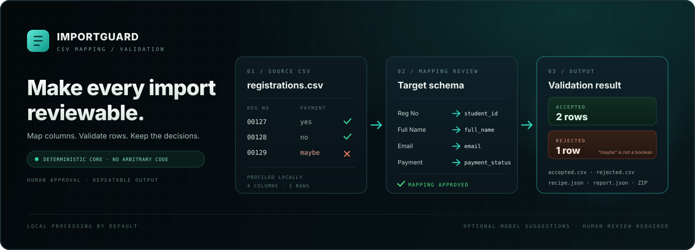

<p align="center">
  
</p>

<h1 align="center">MugdhoAI / <a href="https://github.com/MugdhoAI/ImportGuard">ImportGuard</a></h1>

<p align="center">
  
  <a href="https://github.com/MugdhoAI/ImportGuard/blob/main/LICENSE"></a>
</p>

<p align="center">
  <strong>Live demo:</strong> <a href="https://importguard.onrender.com">importguard.onrender.com</a>
</p>

**ImportGuard is a CSV mapping and validation workspace.** It helps turn an unfamiliar CSV export into a defined target format without silently applying ambiguous changes. Review the column mapping, approve the allowed transformations, validate each row, and keep the resulting recipe for repeatable imports.

- UTF-8 and UTF-8 BOM CSV profile with 5 MB, 5,000 row, and 100 column limits.
- Editable target fields with string, integer, decimal, boolean, and strict `YYYY-MM-DD` date validation.
- Manual mapping and clearly labeled local normalized-header suggestions.
- User approval before deterministic `identity`, `trim`, `collapse_whitespace`, `lowercase`, or `uppercase` operations run.
- Accepted CSV, recoverable rejected CSV with row numbers and errors, versioned recipe JSON, and a report JSON in a ZIP.
- Recipe replay without a model call.
- Optional server-side Meta Muse Spark mapping adapter, disabled by default and requiring a deliberate UI request. Sample values are separately opt-in.
- Planned billing display: Free $0/month, Pro $6.99/month, and Business $19.99/month. These are not active payment offers until a provider is configured; checkout and payment history remain unavailable.

The core workflow runs locally. Meta Muse Spark is an optional mapping assistant; it is not required to use the application.

## The workflow

1. **Import and profile.** Upload a CSV and inspect its columns, row count, and sample values.
2. **Define the target.** Choose output fields, data types, and required fields.
3. **Map and review.** Map columns manually, use local header suggestions, or explicitly request optional Meta suggestions. Review every mapping before processing.
4. **Validate.** Apply the approved transformation allowlist and validate each row against the selected schema.
5. **Export and replay.** Download accepted and rejected records with a report and reusable JSON recipe. Apply a saved recipe to another CSV without another model request.

A row is accepted only when its mapped values pass the selected schema rules. Rejected rows retain their source row number and validation errors.

## What is included

| Area | Current behavior |
| --- | --- |
| CSV input | UTF-8 and UTF-8 BOM; 5 MB, 5,000 data row, and 100 column limits |
| Target schema | Editable fields with string, integer, decimal, boolean, and strict YYYY-MM-DD date types |
| Mapping | Manual mapping and local normalized-header suggestions |
| Optional AI | Meta Muse Spark mapping suggestions through a server-side adapter |
| Review | User approval before transformations are applied |
| Transformations | identity, trim, collapse_whitespace, lowercase, and uppercase |
| Validation | Deterministic, row-level checks against the selected schema |
| Exports | Accepted CSV, rejected CSV, recipe JSON, report JSON, and a ZIP package |
| Replay | Reapply a saved recipe without a model call |
| Accounts and history | Guest and account export history with restorable downloads |
| Billing | Provider-neutral plan and usage model; no payment provider or live checkout |

The transformation engine uses a fixed allowlist. It does not execute arbitrary code from a recipe.

## Run locally

Requirements: Python 3.11 or newer and Node.js 18 or newer for building the landing page.

On Windows PowerShell:

```powershell
git clone https://github.com/MugdhoAI/ImportGuard.git
cd ImportGuard

py -3 -m venv .venv
.\.venv\Scripts\Activate.ps1
python -m pip install --upgrade pip
pip install -r requirements.txt
npm --prefix frontend install
Copy-Item .env.example .env
```

For the documented one-command Windows path, run:

```powershell
.\start-local.bat
```

The launcher rebuilds the frontend and starts Uvicorn on loopback port 8000.
Keep that terminal open, then open `http://127.0.0.1:8000`. If `py -3` is
unavailable, use `python -m venv .venv` and the manual fallback below.

To build and start manually, run:

```powershell
npm --prefix frontend run build
python -m uvicorn app.main:app --host 127.0.0.1 --port 8000
```

The FastAPI application serves the workspace and product pages. The backend
entry point is `app.main:app`. If the frontend has not been built, `/` falls
back to the server-rendered page while `/app`, `/privacy`, and API routes still
work. The browser workflow uses port 8000 by default and accepts
`IMPORTGUARD_URL` when a different local port is intentional.

## Tests and checks

Run the Python checks:

```powershell
python -m pytest -q
python -m ruff check .
```

Run the frontend checks:

```powershell
npm --prefix frontend test
npm --prefix frontend run build
npm --prefix frontend run test:browser
```

The test suite includes CSV parsing, schema and mapping validation, deterministic transformations, exports, recipe replay, account and history behavior, and Meta adapter response handling. Fake-provider tests validate the adapter contract; they do not represent a live Meta request.

The latest recorded verification is in [docs/TEST_LOG.md](docs/TEST_LOG.md). It includes owner-run results and checks that remain blocked by the sandbox environment. Read the log before treating every test category as fully verified.

## Optional Meta integration

Meta mapping suggestions are disabled by default. The normal workflow uses manual mapping and local normalized-header suggestions and does not contact Meta.

To enable the optional integration, configure the server-side environment:

```dotenv
MODEL_API_KEY=your-local-key
ALLOW_META_API_CALLS=true
```

Restart the application. The key must remain on the server and must never be placed in frontend code.

The user must deliberately invoke the Meta action. By default, the request contains source headers and target schema. Up to three example values per column are sent only when the separate opt-in control is selected. Those values may contain personal or confidential information; do not send them without authorization.

A live smoke request to muse-spark-1.3 was verified on 2026-10-30 using synthetic headers only. It returned three mapping suggestions in 18.6 seconds. This confirms that the API round trip worked; it does not establish mapping quality on real data. Review every suggestion before approving it.

Official references: [Meta Chat Completions quickstart](https://dev.meta.ai/docs/cookbook/quickstart-chat-completions), [structured output](https://dev.meta.ai/docs/structured-output), and [models](https://dev.meta.ai/docs/models).

## Optional Google and GitHub sign-in

Email/password authentication works without external credentials. Google and
GitHub OAuth options remain visibly unavailable until each provider is fully
configured on the server. The integration uses server-side authorization-code
exchange, PKCE, one-time expiring state, verified email identities, and an
explicit link flow from Settings. Configure these names in `.env` (never in
frontend code):

```dotenv
OAUTH_STATE_TTL_SECONDS=600
GOOGLE_OAUTH_CLIENT_ID=
GOOGLE_OAUTH_CLIENT_SECRET=
GOOGLE_OAUTH_REDIRECT_URI=http://127.0.0.1:8000/auth/oauth/google/callback
GITHUB_OAUTH_CLIENT_ID=
GITHUB_OAUTH_CLIENT_SECRET=
GITHUB_OAUTH_REDIRECT_URI=http://127.0.0.1:8000/auth/oauth/github/callback
```

The redirect URI must exactly match the URI registered with the provider.
Existing password accounts are not silently merged with an OAuth identity;
the provider email must be verified and matching for an explicit Settings link.

## Abuse and resource limits

The local server applies configurable in-process sliding-window limits to login
and signup failures and the profile, mapping, process, and replay endpoints.
Processing concurrency is bounded, uploads are capped before parsing, recipes
are capped at 64 KB, SQLite uses a busy timeout, and OAuth state expires after
the configured TTL. Defaults and environment variable names are listed in
`.env.example`. These protections are intended for a single local server and
are not a substitute for a deployment-specific proxy, distributed limiter, or
security review.

## Data handling and privacy

CSV uploads are read and processed in memory. Source files are not saved as uploaded files. The application does retain export records for history and restoration: filename, row counts, recipe, report, and the ZIP package are stored in a local SQLite database for the configured retention period (7 days by default).

The default workflow does not send data to Meta. If Meta mapping is enabled and invoked, headers and target schema are sent to the Meta API. Example values are included only after the separate opt-in described above. See the in-app [privacy notice](http://127.0.0.1:8000/privacy) for the current disclosure.

CSV exports guard against spreadsheet formula interpretation. Values beginning with =, +, @, tab, carriage return, and non-numeric - are prefixed with an apostrophe. Ordinary negative numeric values such as -15 are left unchanged. This safeguard applies to exported CSV values; it does not rewrite the in-memory data or recipe.

## Accounts and billing

The CSV workflow can be used as a guest. Accounts allow users to claim guest exports and access their history from the dashboard. Account data, sessions, export records, and subscription state are stored in the configured local SQLite database.

The billing interface currently provides plan and usage state only. No payment provider is integrated, checkout and webhooks are unavailable, and no charges can be made. Quota enforcement remains disabled unless explicitly configured.

## Architecture

ImportGuard uses FastAPI for the application and API routes, server-rendered templates and vanilla JavaScript for the workspace, and Python's standard library for bounded CSV processing.

The main responsibilities are:

- app/services/csv_service.py: CSV parsing, profiling, schema and mapping checks, transformations, row validation, exports, and recipe handling.
- app/services/meta_client.py: optional Meta mapping request and structured response validation.
- app/api/routes.py: CSV profile, mapping, processing, and replay endpoints.
- app/api/accounts.py: account, session, export history, and download routes.
- app/services/store.py: SQLite persistence for users, sessions, exports, and subscription state.
- app/services/auth.py: password hashing, sessions, CSRF checks, and login throttling.
- app/services/billing.py: plan and entitlement state with a provider-neutral billing interface.
- app/main.py: FastAPI application, pages, static assets, and route registration.
- frontend/: landing page source and production build.

See [architecture notes](docs/ARCHITECTURE.md) for the data flow and core invariants.

## Scope and limitations

ImportGuard is an MVP under active development, built as a hackathon and portfolio project. It is not a certified data migration system, and passing validation does not guarantee that accepted records are semantically correct.

- Mapping suggestions can be wrong. A person must review and approve them.
- Validation enforces only the selected schema rules. It does not deduplicate records or infer ambiguous formats.
- The optional Meta integration is not required for the core workflow.
- Billing screens do not represent a functioning payment service.
- Do not use the application with confidential or regulated data unless your deployment, access controls, retention, and operating environment have been independently reviewed.

See [project status](docs/PROJECT_STATUS.md), [test plan](docs/TEST_PLAN.md), and [third-party notices](docs/THIRD_PARTY_NOTICES.md) for implementation status, verification scope, and dependency attributions.

## License

MIT. See [LICENSE](LICENSE).
